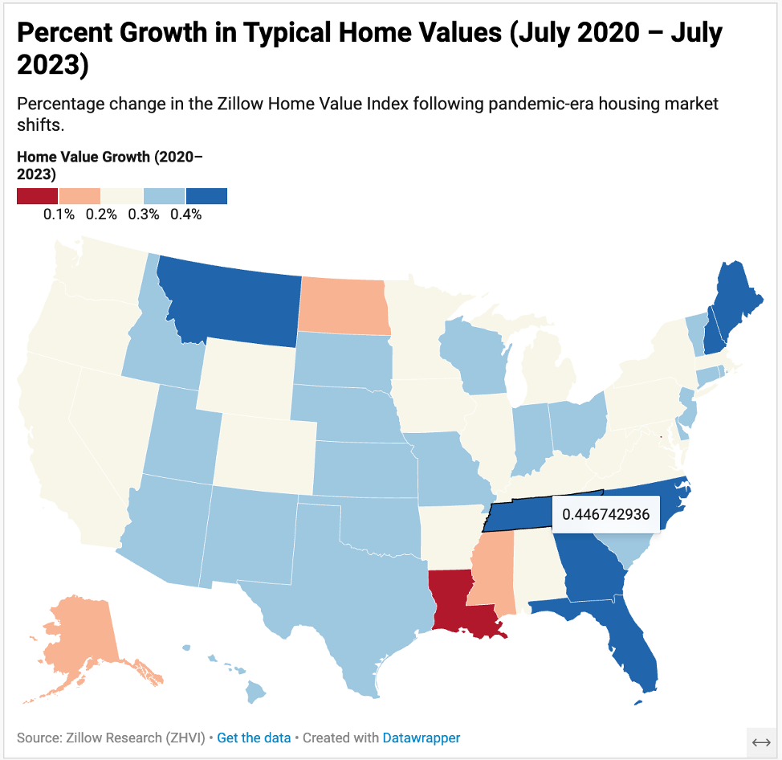
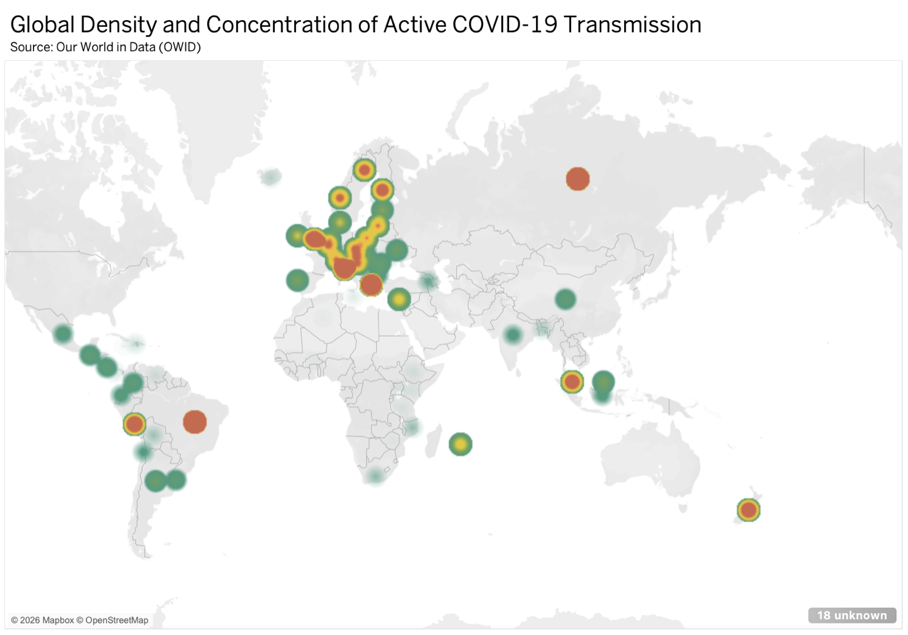

# Geospatial Housing & COVID-19 Analytics

A comparative geospatial visualization project evaluating U.S. housing market shifts and global pandemic transmission dynamics. This project applies cartographic design principles, normalization strategies, and accessibility standards (WCAG) across Datawrapper and Tableau Desktop.

---

## Project Overview

### 1. U.S. Typical Home Value Shifts (Zillow Research ZHVI)
* **Objective:** Analyze longitudinal shifts in middle-tier home prices between July 2020 and July 2023 across all 50 U.S. states and Washington, D.C.
* **Methodology:** 
  * Extracted and transformed monthly ZHVI time-series data, computing a custom relative growth field:
    $$\Delta = \frac{\text{Value}_{2023} - \text{Value}_{2020}}{\text{Value}_{2020}}$$
  * Developed a 4-tier quartile choropleth to visualize baseline distribution across varied geographic markets.
  * Designed a 5-step diverging map centered on median national appreciation (~33.8%) to highlight market acceleration in the Mountain West and Sunbelt vs. coastal stagnation.
* **Tools Used:** Datawrapper, Microsoft Excel, R (`dplyr`)
* **Live Interactive Map:** [View on Datawrapper](https://datawrapper.dwcdn.net/eKTlC/1/)

---

### 2. Global COVID-19 Spatial Patterns (Our World in Data)
* **Objective:** Compare epidemic scale, transmission density, and population-adjusted burdens using distinct cartographic architectures.
* **Visual Encodings:**
  1. **Choropleth (Filled Map):** Mapped `total_cases_per_million` using sequential gradients to display reporting rates without administrative boundary distortion.
  2. **Proportional Symbol (Bubble Map):** Scaled circle areas to cumulative mortality (`total_deaths`) segmented by continent to compare absolute scale.
  3. **Spatial Density (Heatmap):** Rendered localized case clusters to reveal transmission corridors independent of national boundaries.
* **Data Integrity & Filtering:** Filtered time-series observations to a single terminal date snapshot to prevent multi-year cumulative double-counting.
* **Tools Used:** Tableau Desktop, OpenStreetMap/Mapbox

| Map Type | Variable Encoded | Visual Channel |
| :--- | :--- | :--- |
| Choropleth | Cases per Million | Color Hue / Saturation |
| Proportional Symbol | Total Cumulative Deaths | Mark Diameter / Area |
| Density Surface | Active Case Clusters | Gaussian Kernel Smoothing |

---

## Technical Skills Applied
* **Data Processing:** Aggregation, relative growth indexing, outlier auditing, single-snapshot date filtering.
* **Geospatial & BI:** Tableau Desktop, Datawrapper, Mapbox integration.
* **Cartographic Best Practices:** Stepped vs. continuous scales, diverging vs. sequential palette selection, WCAG colorblind accessibility, custom tooltip formatting.
* **Links to Tableau Graphs:** https://public.tableau.com/shared/7MB264M55?:display_count=n&:origin=viz_share_link 
https://public.tableau.com/shared/5J9MCM67T?:display_count=n&:origin=viz_share_link
https://public.tableau.com/shared/GX84FCG2F?:display_count=n&:origin=viz_share_link